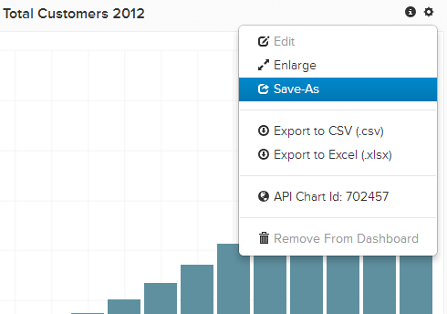

# Importa grafico da un altro utente

È possibile modificare un grafico di proprietà di un altro utente o creare un grafico simile. È facile importare un grafico di cui un altro utente è attualmente proprietario e salvarlo nel proprio dashboard.

## Trovare il grafico

Individuare innanzitutto il grafico da copiare dall&#39;altro utente. Tutte le dashboard condivise con te si trovano nella barra laterale `Dashboard` dove sono contrassegnate da un&#39;icona condivisa. Fai clic sul dashboard desiderato.

## Clona il grafico

Nel dashboard condiviso, scegliere il grafico che si desidera copiare nel proprio account. Fare clic sull&#39;icona dell&#39;ingranaggio () e quindi fare clic su **[!UICONTROL Save As]**.

Viene richiesto di assegnare un nome alla copia del grafico e di aggiungerla a una delle dashboard esistenti. Se non selezioni un dashboard, questo verrà aggiunto all&#39;elenco dei grafici esistenti e potrai [aggiungerlo in un secondo momento](../../data-user/dashboards/add-charts-dashboard.md).

